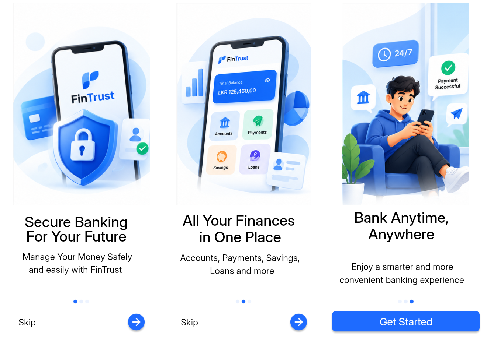

# FinTrust Banking App — Flutter Assignment

All 31 screens from the Prototype page in Figma file
`8OZoDculYSBV0db4klPrCD`, imported from the supplied `../Assaighnment.fig`.
The original artwork, chart, text outlines, and 73 prototype navigation links
are bundled locally. No Figma connection is needed to run the app.



## Run

```bash
git clone https://github.com/rizhamhd/fintrust-banking-app.git
cd fintrust-banking-app
flutter pub get
flutter run -d linux
```

To build a Linux desktop executable (requires the Flutter Linux toolchain):

```bash
flutter build linux --debug
./build/linux/x64/debug/bundle/fintrust_banking_app
```

Keep the executable together with its bundle's `lib/` and `data/` directories.

Follow onboarding, enter any nonempty email/mobile number and password, then
use verification code **123456**. Long-press a screen to open the screen index.

## Screens and interactions

Includes splash, three onboarding screens, login, verification, biometrics,
dashboard, accounts and details, transaction history and details, search,
transfer options, beneficiary selection and creation, transfer details/review/
success, QR Pay, bill payments, mobile reload, cards and controls, savings goals
and creation, budget/spending, insights, notifications, assistant, and profile.

Transfers validate amounts and update the session's sample balance after
confirmation. Beneficiary selection carries into transfer review; new
beneficiaries are saved for the current session. Savings goals validate a name,
amount and date. Search and history filters, notification controls, card switches,
and profile preferences work locally. The assistant uses predefined demo replies.

This is an interactive coursework prototype. Authentication, payments, biometric
hardware, QR camera scanning, live AI, and persistent banking storage are not
connected. Demo dialogs supplement actions that have no corresponding design
screen. Nothing sends money or contacts a bank.

## Design fidelity

Each screen retains its original 440 × 956 coordinates, scales down on narrow
displays, and scrolls on shorter displays. Desktop layouts center the mobile
frame. Original individual artwork layers are rendered at 3x resolution; text uses bundled variable fonts and Flutter’s native text renderer for consistent
sharpness in labels and editable fields. Original Figma baselines, sizes, and
weights are retained; exact overlapping duplicate labels are rendered once.
Input hints use the prototype’s light font weight.
Onboarding illustrations use the original embedded pictures directly. Runtime
crops exclude screenshot borders and embedded UI; proportional containment fits
the illustration into a 440 × 550 area above the headings without stretching. The runtime does
not display flattened full-screen screenshots.

Original geometry and illustrations are preserved. Exact pixel equality across
Flutter and Figma is not guaranteed because rasterization, native input controls,
and device safe areas differ.

## Project structure

- `lib/main.dart`: screen rendering, navigation, transfers, reloads, card controls.
- `lib/prototype_flows.dart`: remaining screen interactions and demo state.
- `lib/design_glyphs.dart`: retained original outline renderer for reference;
  the app now uses native text rendering.
- `assets/design.json`, `assets/glyphs.json`: all screens and original glyph paths.
- `assets/local/`: original individual artwork layers and rendered PNG assets.
- `design/local/reference/`: reference renders generated from original geometry.
- `design/local/document.json`: decoded local Figma data.
- `tool/fig_decoder/`: local Figma Kiwi decoder; development tooling only.
- `tool/import_local_fig.py`: rebuilds the current assets from the local export.
- `test/widget_test.dart`: interaction, viewport, and all-screen render checks.
- `test/previews/`: rendered Flutter regression baselines for all 31 screens.

The older `tool/import_design.py`, `design/reference/`, and `assets/figma/` retain
the initial partial online extraction. Do not run that importer over the complete
local import.

## Checks

```bash
flutter analyze
flutter test --no-pub
flutter build linux --debug --no-pub
```

Golden images check regressions; they are not an independent proof of pixel
identity with Figma. Android and iOS builds have not been verified.

The original `Assaighnment.fig` is not required to run the app. To regenerate
assets with the development importer, place that export in the parent directory
and install its Python (Pillow), Node, and librsvg tooling dependencies.
